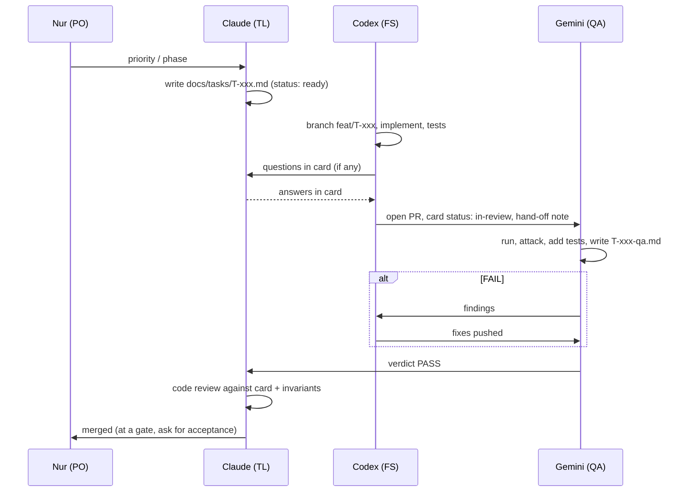

# How the AI agents work together

| Who | Role | Reads | Writes |
| --- | --- | --- | --- |
| Nur | Product owner | Everything | Scope, priorities, gate approvals, anything with real money |
| Claude | Tech lead | Everything | Docs, ADRs, task cards, reviews, merges |
| Codex | Full-stack engineer | Task card + linked docs | Code, tests, migrations, PRs |
| Gemini | QA engineer | Task card, PR, docs | Tests, QA reports, bug cards, `docs/test-plan.md` |

All agents start each session cold. **Anything another agent needs must be written in the repo** (task card, report, ADR), not only in a chat.

## The loop for one task



## Task card states

`draft` → `ready` → `in-progress` → `in-review` → `qa-pass` → `done` (or `blocked` with a reason).
The state lives in the card's front matter and is updated by whoever moves it.

## Branches and commits

- `main` is always deployable. No direct pushes; PRs only.
- Branch names: `feat/T-xxx-…`, `fix/BUG-xxx-…`, `test/T-xxx-…` (Gemini), `docs/…` (Claude).
- Conventional commits: `feat(order): claim with waitlist fallback (T-203)`.
- Gemini's tests for a feature go in the same PR when possible (push to Codex's branch) or a follow-up `test/` PR linked in the QA report.

## Conflict rules

1. Docs win over code. If the code is right and the doc is wrong, Claude updates the doc.
2. Claude decides technical disputes between Codex and Gemini and records the reason in the card.
3. Nur decides anything about scope, money, users or legal risk.
4. Security or money findings marked critical stop the merge, no exceptions.

## Running the three agents

Each agent gets its own working copy (git worktree) to avoid stepping on each other:

```bash
git worktree add ../dk-codex  -b feat/T-xxx
git worktree add ../dk-gemini  feat/T-xxx      # QA checks out the same branch after the PR opens
```

Suggested prompts to start a session:

- **Claude:** "Read CLAUDE.md. Next phase is P2. Write task cards T-201..T-206 and update the plan if needed."
- **Codex:** "Read AGENTS.md and docs/tasks/T-203.md. Implement it and open a PR."
- **Gemini:** "Read GEMINI.md and docs/tasks/T-203.md. Review the PR on branch feat/T-203-claim and write the QA report."
