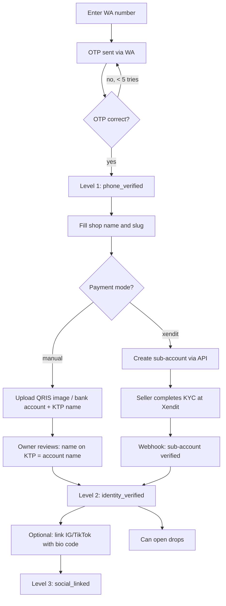
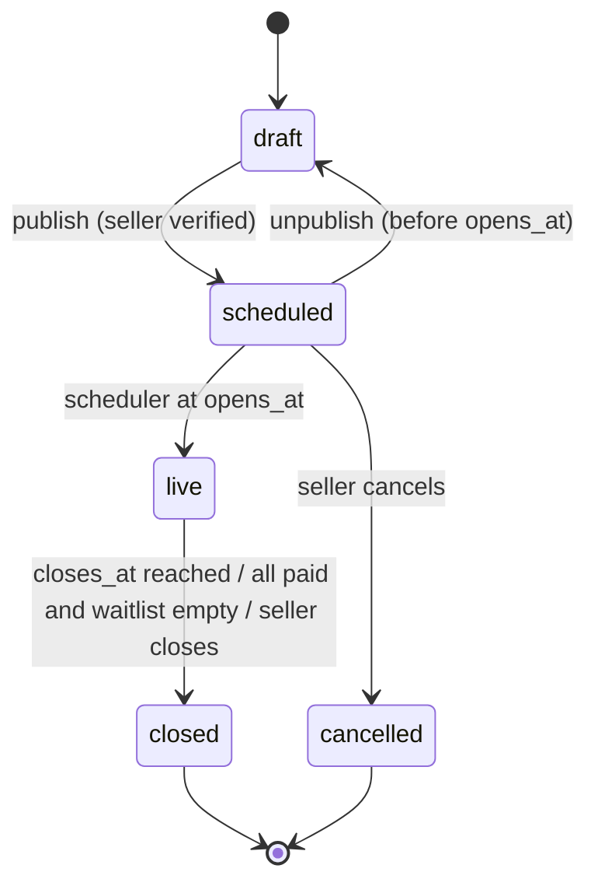
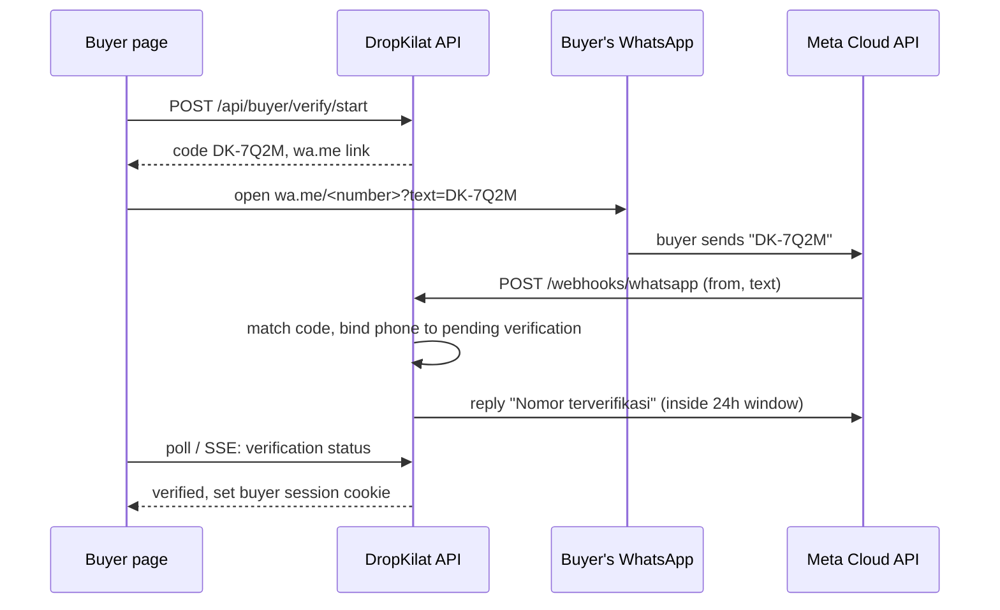
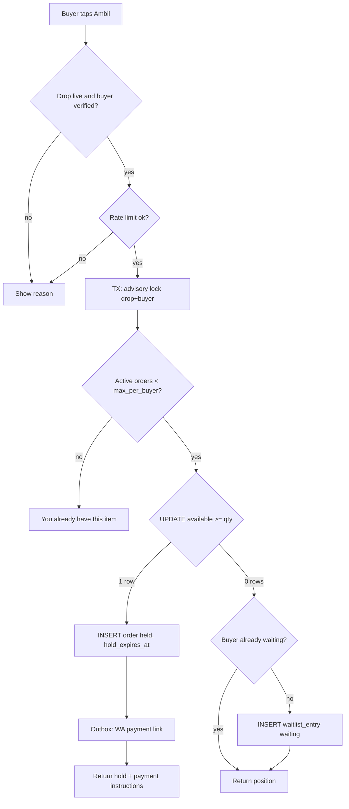
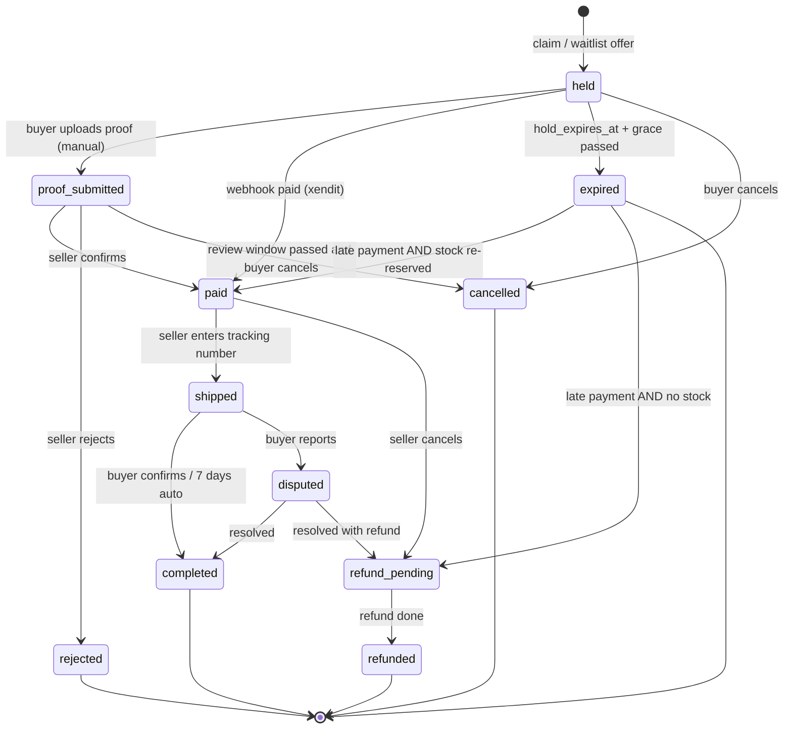
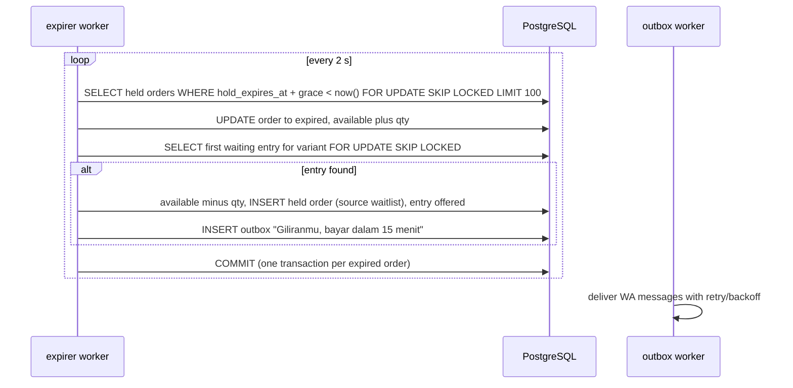
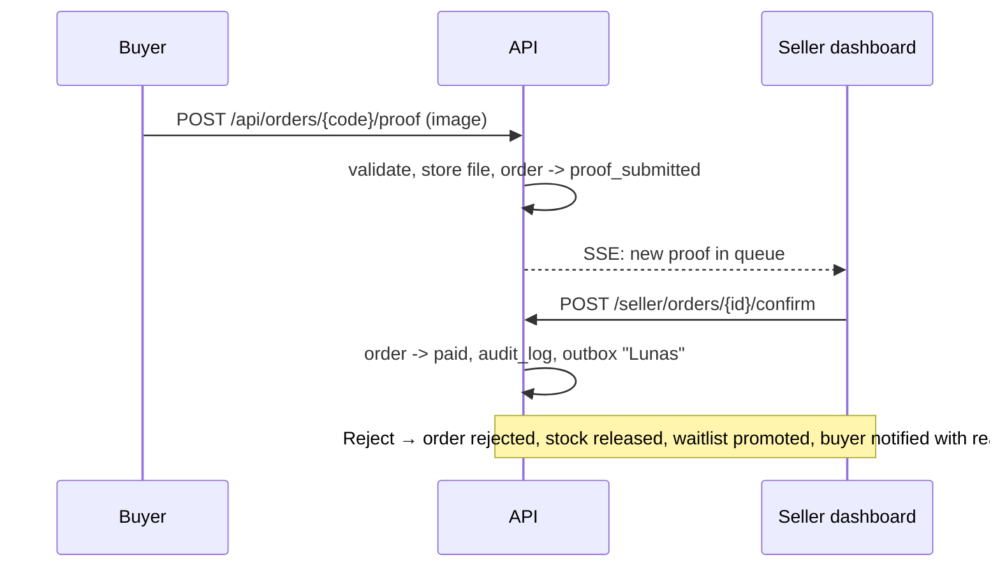
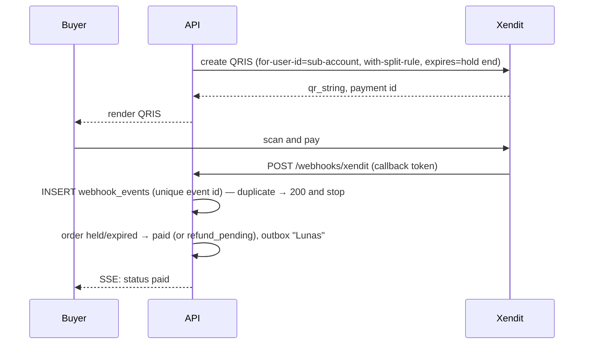

# App flow — DropKilat

Diagrams are Mermaid; they render on GitHub. State names here are the exact values stored in the database.

## 1. Seller onboarding

## 2. Drop lifecycle

Rules: a `live` drop can only gain stock or be closed; variants and prices are frozen once `scheduled`.

## 3. Buyer verification (buyer-initiated WhatsApp)

Fallback when the buyer cannot open WA on this device: OTP template sent to the typed number.

## 4. Claim

## 5. Order state machine

Stock effects:
- Entering `held` decrements `available` (inside the claim or promotion transaction).
- Leaving to `expired`, `cancelled`, `rejected` increments `available` and triggers promotion.
- `proof_submitted` keeps the stock locked (no timer) until the seller decides.
- `refund_pending` from `paid` (seller cancel) does **not** return stock automatically; the seller decides.

## 6. Hold expiry and waitlist promotion

If an offered buyer does not pay, their order expires like any other and the next entry is promoted. Entries are marked `skipped` if the buyer already has an active order for that variant.

## 7. Manual payment

## 8. Automatic payment (Xendit)

## 9. Fulfilment

1. Paid → buyer fills address (required before seller can ship).
2. Seller enters tracking number (single or CSV bulk) → `shipped`, WA to buyer.
3. Buyer taps "Barang sudah diterima" → `completed`, or auto after 7 days.
4. Buyer reports → `disputed`; owner and seller see it; resolution recorded in `audit_log`.

## 10. Seller emergency close

Seller taps **Tutup drop** → confirm dialog → drop `closed`; active holds keep running until they expire or are paid; waitlist entries become `closed` and buyers are notified "Drop ditutup oleh seller".
