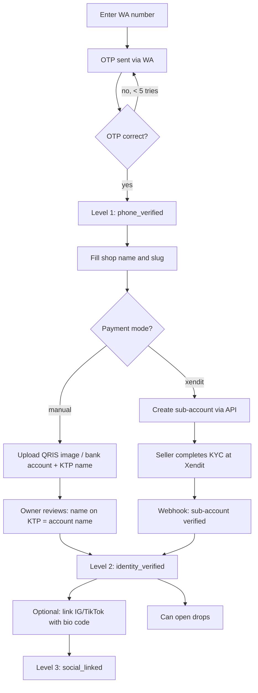
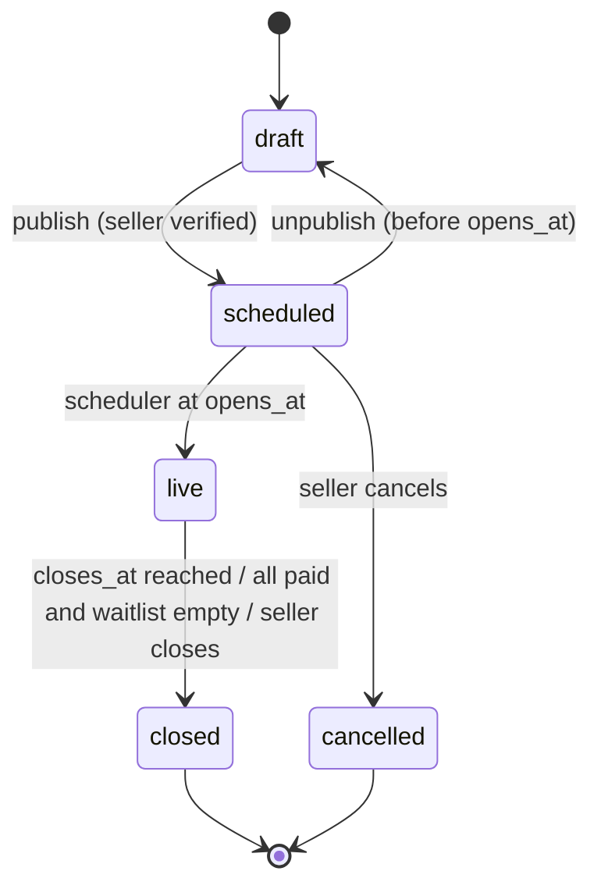
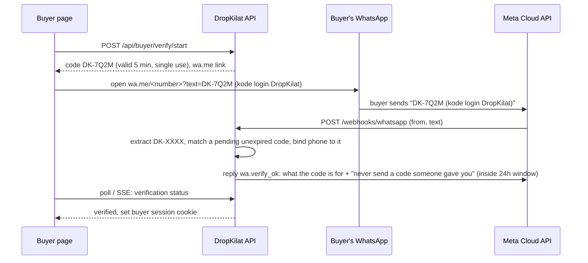
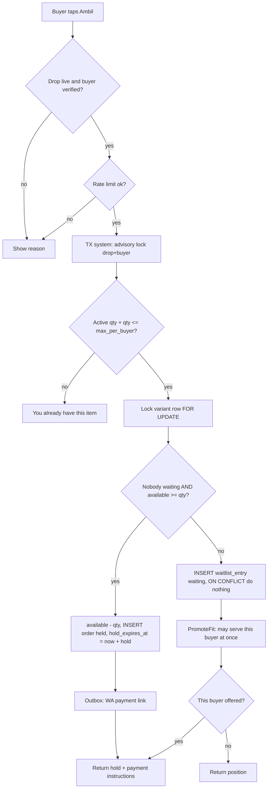
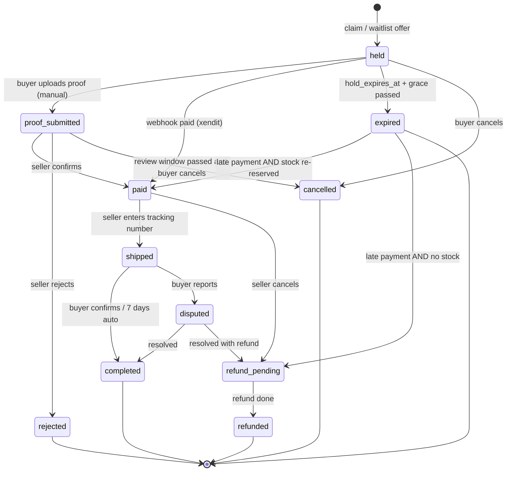
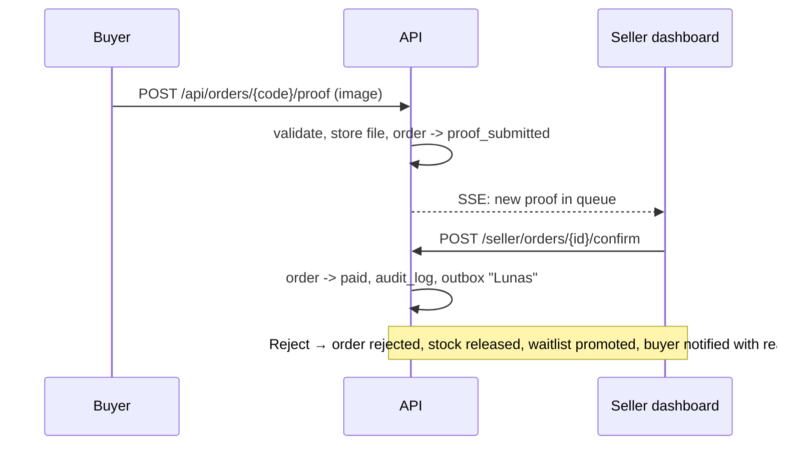
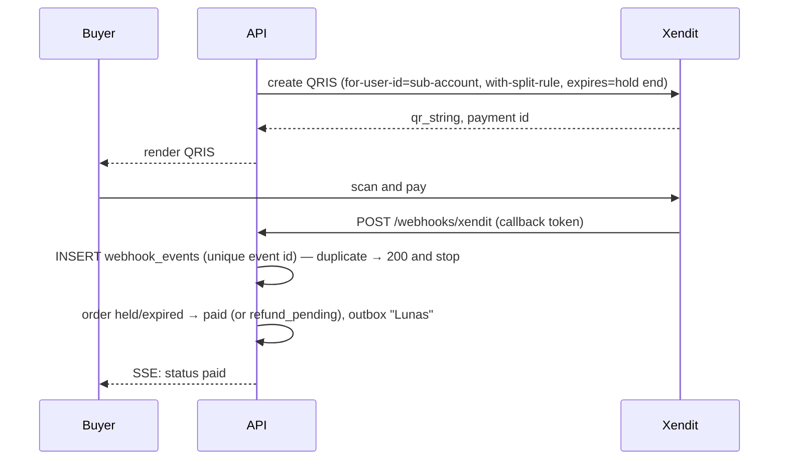

# App flow — DropKilat

Diagrams are Mermaid; they render on GitHub. State names here are the exact values stored in the database.

## 1. Seller onboarding



## 2. Drop lifecycle



Rules: a `live` drop can only gain stock or be closed; variants and prices are frozen once `scheduled`.

## 3. Buyer verification (buyer-initiated WhatsApp)



Fallback when the buyer cannot open WA on this device: OTP template sent to the typed number.

Phishing mitigations (ADR 0003 amendment):
- Codes expire 5 minutes after start, bind one phone, and cannot be reused.
- The `wa.verify_ok` reply says the number was just logged in to DropKilat on the device that requested the code, names the shop, and warns never to send a DropKilat code from someone else (copy in `docs/design.md` §9).
- The recipient name, phone and address of earlier orders are masked on buyer pages. Showing them needs a step-up: a fresh code or OTP on this session in the last 10 minutes.

## 4. Claim



## 5. Order state machine



Stock effects (complete list of stock paths: `docs/database-schema.md` §6a; accounting rule: ADR 0005):
- Entering `held` decrements `available` and sets `holds_stock = true` (inside the claim or promotion transaction).
- Leaving to `expired`, `cancelled`, `rejected` sets `holds_stock = false`, increments `available` and runs promotion, all in one transaction.
- `proof_submitted` keeps the stock locked (no hold timer). The seller has a review deadline instead (§7).
- `expired → paid` re-reserves stock (`holds_stock = true`, `available − qty`). Without stock the order goes to `refund_pending` and no stock moves.
- `refund_pending` from `paid` (seller cancel) returns stock only if the seller chooses "kembalikan stok"; otherwise `holds_stock` stays true.

## 6. Hold expiry and waitlist promotion

```mermaid
sequenceDiagram
  participant W as expirer worker
  participant DB as PostgreSQL
  participant O as outbox worker
  loop every 2 s, until no due hold is left
    W->>DB: BEGIN; pick one held order WHERE hold_expires_at + grace < $now FOR UPDATE SKIP LOCKED
    W->>DB: lock variant row; order expired, holds_stock false, available plus qty
    loop PromoteFit while available > 0 and drop live
      W->>DB: oldest waiting entry with qty <= available, FOR UPDATE SKIP LOCKED
      W->>DB: available minus qty, INSERT held order (source waitlist), entry offered
      W->>DB: INSERT outbox "Giliranmu, bayar dalam 15 menit"
    end
    W->>DB: COMMIT (one transaction per expired order)
  end
  O->>O: deliver WA messages with retry/backoff
```

If an offered buyer does not pay, their order expires like any other and the next entry is promoted.

Promotion rules (ADR 0005):
- **First fit in FIFO order.** An entry whose qty does not fit keeps its place while smaller entries behind it are served.
- **Skips.** An entry is `skipped` if its buyer is blocked in this shop or would exceed `max_per_buyer`. It stays `waiting` (and is tried next time) if the buyer is claiming at that moment.
- **Triggers.** The same `PromoteFit` runs after every release (expiry, cancel, reject, review-window cancel, seller cancel with stock return), after a stock increase, and after every enqueue.
- **Queue first.** A new claim never takes stock while someone is waiting.

## 7. Manual payment



Review deadline (PO decision 2026-11-11, task T-406):

| Proof submitted while… | `review_due_at` | At the deadline | Buyer may cancel |
| --- | --- | --- | --- |
| the drop is `live` | `proof_submitted_at + 60 min` | order flagged **Terlambat direview** (`review_late_at`), warning on the dashboard and by WA to the seller. No auto-reject. | from `proof_submitted_at + 6 h` |
| the drop is not live | `proof_submitted_at + 6 h` | same flag and warning | from `proof_submitted_at + 6 h` |

The `reviewer` worker sets the flags (`docs/backend.md` §5). A buyer cancel after 6 h is stock path 6.

**Tolak dan blokir pembeli di toko ini.** Next to Reject, the seller can reject *and* block the buyer in one transaction:
- The order is `rejected` and its stock released and promoted (path 5).
- A row is added to `shop_buyer_blocks`, and the buyer's `waiting` entries in this shop become `skipped`.
- One `audit_log` row is written.
- From then on, claims and promotions for that buyer in this shop fail with `buyer-blocked`.

The block is per shop only (PRD non-goal: no cross-shop blacklist). The seller can lift it in the shop profile.

## 8. Automatic payment (Xendit)



## 9. Fulfilment

1. Paid → buyer fills address (required before seller can ship).
2. Seller enters tracking number (single or CSV bulk) → `shipped`, WA to buyer.
3. Buyer taps "Barang sudah diterima" → `completed`, or auto after 7 days.
4. Buyer reports → `disputed`; owner and seller see it; resolution recorded in `audit_log`.

## 10. Seller emergency close

Seller taps **Tutup drop** → confirm dialog → drop `closed`; active holds keep running until they expire or are paid; waitlist entries become `closed` and buyers are notified "Drop ditutup oleh seller".
