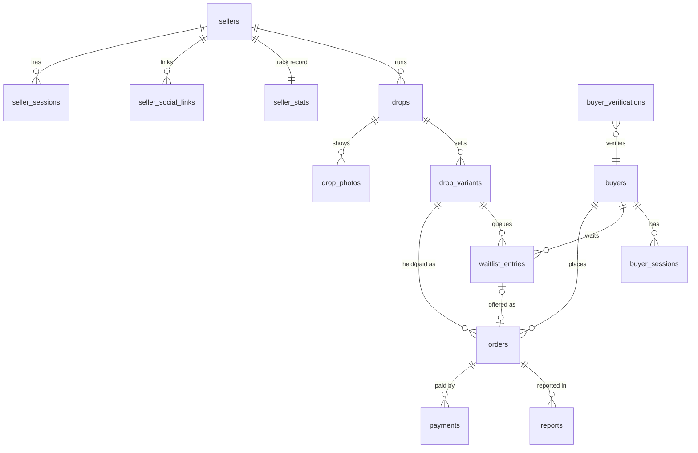

# Database schema — DropKilat

Source of truth: `migrations/`. This doc explains the why. PostgreSQL 17 in production; the initial migration was also verified on PostgreSQL 16 (up → down → up).

Conventions: `uuid` ids (UUIDv7 generated by the app), money in `BIGINT` rupiah, time in `timestamptz` UTC, enums as `text` + `CHECK`, PII encrypted by the app (`*_enc bytea`) with an HMAC lookup column (`*_hash bytea`).

## 1. Entity relationships



Standalone: `otp_challenges`, `webhook_events`, `outbox`, `audit_log`.

## 2. Tables

| Table | Purpose | Notes |
| --- | --- | --- |
| `sellers` | Shop account, verification timestamps, payment destination | `limited_until_trusted` drives new-seller limits |
| `seller_sessions` | Dashboard sessions | Token stored as SHA-256 hash |
| `otp_challenges` | OTP for seller login and buyer fallback | Max 5 attempts, code hashed |
| `seller_social_links` | IG/TikTok handle proof | `UNIQUE (platform, handle)` stops two shops claiming one handle |
| `seller_stats` | Track record shown to buyers | Updated by the app on order events |
| `drops` | One drop / PO | Status machine in `docs/app-flow.md` §2 |
| `drop_photos` | Photos | Files on the uploads volume |
| `drop_variants` | Variant with `stock_total` and `available` | **`CHECK (available >= 0 AND available <= stock_total)` is the last line against oversell** |
| `buyers` | Verified buyer phone | One row per phone across all shops |
| `buyer_sessions` | Buyer browser sessions (90 days) | |
| `buyer_verifications` | Pending buyer-initiated WA codes (`DK-XXXX`) | Page holds the nonce; WA webhook resolves the code |
| `orders` | Hold → paid → shipped → completed | Status machine in `docs/app-flow.md` §5; `holds_stock` (000003) says whether it consumes stock |
| `waitlist_entries` | FIFO queue per variant | One `waiting` row per buyer per variant (partial unique index) |
| `payments` | One row per payment attempt | `UNIQUE (provider, provider_ref)` |
| `webhook_events` | Raw inbound webhooks (Xendit, WhatsApp) | `UNIQUE (provider, event_id)` = idempotency |
| `outbox` | Side effects to deliver (WA messages) | `dedupe_key` stops duplicate sends |
| `reports` | Buyer reports | |
| `audit_log` | Append-only log of money and trust actions | App role has no UPDATE/DELETE |

## 3. Indexes that matter

| Index | Serves |
| --- | --- |
| `orders_hold_expiry_idx (hold_expires_at) WHERE status='held'` | Expiry worker scan |
| `orders_drop_buyer_active_idx (drop_id, buyer_id) WHERE active` | Max-per-buyer check |
| `waitlist_fifo_idx (variant_id, created_at, id) WHERE status='waiting'` | Promotion picks the oldest entry |
| `waitlist_one_waiting_per_buyer` (unique, partial) | No double queueing |
| `outbox_due_idx (send_after) WHERE pending` | Outbox worker |
| `drops_schedule_idx (status, opens_at)` | Scheduler opens/closes drops |

## 4. Row level security

Tenant tables (`drops`, `drop_photos`, `drop_variants`, `orders`, `waitlist_entries`, `payments`, `seller_social_links`, `reports`) have `FORCE ROW LEVEL SECURITY`. The tenant policy from migration 000001 is:

```sql
USING (app_is_system() OR seller_id = app_seller_id())
```

Migration 000002 (ADR 0004, task T-102) narrows `app_is_system()` to `system` only and adds read policies for `public`/`buyer` and own-row write policies for `buyer`.

The app connects as `dropkilat_app` (not the owner) and sets the context per transaction through `platform/db`:

| Context | Helper | Setting | Can do |
| --- | --- | --- | --- |
| Seller dashboard request | `WithSellerTx` | `SET LOCAL app.seller_id = '<seller uuid>'` | Own tenant rows |
| Workers, webhook processing, **every stock or queue change** (§6a) | `WithSystemTx` | `SET LOCAL app.role = 'system'` | Everything |
| Verified buyer, no stock change | `WithBuyerTx` | `app.role = 'buyer'`, `app.buyer_id = '<buyer uuid>'` | Read published catalog, own orders/entries/payments; update own orders and entries; report on own orders |
| Anonymous page views | `WithPublicTx` | `SET LOCAL app.role = 'public'` (read-only tx) | Read published catalog and verified social links |

With nothing set, tenant tables return zero rows. As the app role, `DELETE FROM audit_log` fails with permission denied. Results of the 000002 policies are recorded in ADR 0004.

RLS is the second line of defence. Every seller query still filters by `seller_id` explicitly, and buyer queries filter by `buyer_id` from the session.

## 5. Claim (reference, verified)

One transaction under `system` (ADR 0004). `$now` comes from `clock.Clock` (ADR 0005). Verified on PostgreSQL 16: 500 buyers × 2 claims each from 40 parallel connections on 50 stock gave exactly 50 `held`, 450 `waiting`, and the invariant held.

```sql
BEGIN;
SET LOCAL app.role = 'system';
-- 1. the drop must be live (plain read, no FOR SHARE)
SELECT max_per_buyer, hold_minutes, payment_mode FROM drops
 WHERE id = $drop AND status = 'live' AND $now >= opens_at AND $now < closes_at;
--    0 rows → drop-not-live
--    buyer blocked in this shop (shop_buyer_blocks, T-406) → buyer-blocked
-- 2. serialize this buyer within this drop (max_per_buyer without races)
SELECT pg_advisory_xact_lock(hashtextextended($drop::text || $buyer::text, 0));
-- 3. quantity this buyer already has in this drop
SELECT coalesce(sum(qty), 0) FROM orders
 WHERE drop_id = $drop AND buyer_id = $buyer
   AND status IN ('held','proof_submitted','paid','shipped','completed','disputed');
--    sum + $qty > max_per_buyer → already-claimed
-- 4. lock the variant: every stock or queue change on a variant takes this lock first
SELECT available, price, seller_id FROM drop_variants
 WHERE id = $variant AND drop_id = $drop FOR UPDATE;
-- 5. queue first
SELECT EXISTS (SELECT 1 FROM waitlist_entries WHERE variant_id = $variant AND status = 'waiting');
-- 6a. no one waiting and available >= $qty → hold
UPDATE drop_variants SET available = available - $qty WHERE id = $variant;
INSERT INTO orders (code, seller_id, drop_id, variant_id, buyer_id, qty, unit_price, amount,
                    payment_mode, status, hold_expires_at)         -- holds_stock defaults to true
VALUES ($code, $seller, $drop, $variant, $buyer, $qty, $price, $price * $qty,
        $mode, 'held', $now + make_interval(mins => $hold_minutes));
INSERT INTO outbox (kind, dedupe_key, payload) VALUES ('wa.payment_link', 'order:<id>:payment_link', ...);
-- 6b. otherwise → enqueue, then promote (§6); if this buyer's entry was offered the result is "held"
INSERT INTO waitlist_entries (seller_id, drop_id, variant_id, buyer_id, qty)
VALUES ($seller, $drop, $variant, $buyer, $qty)
ON CONFLICT (variant_id, buyer_id) WHERE status = 'waiting' DO NOTHING;
-- waitlist.PromoteFit(tx, $variant, $now)
COMMIT;
```

## 6. Expiry and promotion (reference, verified)

One transaction per expired order under `system`. Several workers can run in parallel thanks to `SKIP LOCKED`. Verified on PostgreSQL 16: 3 parallel expirers released 10 holds while 30 new buyers claimed. Waitlist positions #1–#10 were promoted in order, all 30 newcomers were queued behind them, and the invariant held.

```sql
BEGIN;
SET LOCAL app.role = 'system';
-- 1. pick one due hold (lock order: order row → variant row → waitlist entries)
SELECT o.id, o.variant_id, o.qty FROM orders o JOIN drops d ON d.id = o.drop_id
 WHERE o.status = 'held'
   AND o.hold_expires_at + make_interval(secs => d.grace_seconds) < $now
 ORDER BY o.hold_expires_at
 FOR UPDATE OF o SKIP LOCKED LIMIT 1;
SELECT available FROM drop_variants WHERE id = $variant FOR UPDATE;
-- 2. expire it and return its stock in the same transaction
UPDATE orders SET status = 'expired', holds_stock = false, ended_at = $now WHERE id = $order;
UPDATE drop_variants SET available = available + $qty WHERE id = $variant;
-- 3. waitlist.PromoteFit(tx, $variant, $now)
COMMIT;
```

`waitlist.PromoteFit(tx, variantID, now)` assumes the variant row is locked. It does nothing unless the drop is `live` and `now < closes_at`. Then it loops:

```sql
-- next candidate: oldest waiting entry that fits (first fit in FIFO order)
SELECT id, buyer_id, qty FROM waitlist_entries
 WHERE variant_id = $variant AND status = 'waiting' AND qty <= $available
   AND id <> ALL ($tried)
 ORDER BY created_at, id
 FOR UPDATE SKIP LOCKED LIMIT 1;
--   none → stop
--   NOT pg_try_advisory_xact_lock(hashtextextended($drop::text || $buyer::text, 0))
--       → buyer is claiming right now: add to $tried, keep waiting, next candidate
--   buyer blocked in this shop, or active qty + entry qty > max_per_buyer
--       → UPDATE waitlist_entries SET status = 'skipped'; next candidate
UPDATE drop_variants SET available = available - $qty WHERE id = $variant;
INSERT INTO orders (code, seller_id, drop_id, variant_id, buyer_id, qty, unit_price, amount,
                    payment_mode, source, status, hold_expires_at)
VALUES ($code, $seller, $drop, $variant, $buyer, $qty, $price, $price * $qty,
        $mode, 'waitlist', 'held', $now + make_interval(mins => $hold_minutes));
UPDATE waitlist_entries SET status = 'offered', offered_at = $now, order_id = $order WHERE id = $entry;
INSERT INTO outbox (kind, dedupe_key, payload) VALUES ('wa.waitlist_turn', 'order:<id>:waitlist_turn', ...);
-- repeat while available > 0
```

## 6a. Stock paths (complete list)

Only these change `drop_variants.available` or `stock_total`, or `orders.holds_stock`. Each runs in one `system` transaction that locks the variant row first, and each ends with `PromoteFit` when stock was released or added.

| # | Path | Package | Effect |
| --- | --- | --- | --- |
| 1 | Claim | `order` | `available − qty`, order `held` |
| 2 | Promotion | `waitlist` | `available − qty`, order `held` (source `waitlist`) |
| 3 | Expiry | `order` (expirer) | `held → expired`, release |
| 4 | Buyer cancels a hold | `order` | `held → cancelled`, release |
| 5 | Seller rejects a proof (optionally blocks the buyer, T-406) | `order` | `proof_submitted → rejected`, release |
| 6 | Buyer cancels after the 6 h review window | `order` | `proof_submitted → cancelled`, release |
| 7 | Late payment after expiry | `payment` → `order` | `expired → paid` with `available − qty`, `holds_stock = true`; no stock → `refund_pending`, no change |
| 8 | Seller cancels a paid order | `order` | `paid → refund_pending`; release only if the seller chooses "kembalikan stok" |
| 9 | Seller adds stock (draft, scheduled or live) | `drop` | `stock_total + n`, `available + n` |

Invariant per variant, checked by T-205: `available + Σ qty (orders WHERE holds_stock) = stock_total` and `0 ≤ available ≤ stock_total`.

## 7. Webhook idempotency

```sql
INSERT INTO webhook_events (provider, event_id, event_type, payload)
VALUES ($1, $2, $3, $4)
ON CONFLICT (provider, event_id) DO NOTHING
RETURNING id;      -- no row → duplicate: answer 200, do nothing
```

Processing then locks the order (`SELECT ... FOR UPDATE`) and applies the transition only if the current status allows it. `processed_at` and `result` are set in the same transaction.

## 8. Retention and privacy

| Data | Kept for |
| --- | --- |
| Shipping address, recipient phone | Deleted 90 days after `completed` / `refunded` |
| Payment proofs | Deleted 90 days after order end |
| `webhook_events.payload` | 180 days |
| `audit_log` | 2 years |
| Expired `buyer_verifications`, consumed `otp_challenges` | 7 days |

A nightly job (`retention`) performs the deletes and writes one `audit_log` row per run.

## 9. Migration rules

1. Forward-only in production; every `up` has a `down` for local use.
2. Never edit a merged migration. Add a new one.
3. New tenant tables must include `seller_id` and the RLS policy in the same migration.
4. Run `make migrate-check` (up → down → up on a fresh DB) in CI.

## 10. Planned migrations

Decided but not yet merged. Each lands in its task's PR; this section is removed once the migration is on `main`.

| Migration | Task | Change |
| --- | --- | --- |
| `000002_rls_contexts` | T-102 | `app_is_system()` = `system` only; `app_is_public()`, `app_buyer_id()`; public/buyer policies (ADR 0004) |
| `000003_orders_holds_stock` | T-203 | `orders.holds_stock` + CHECK (ADR 0005) |
| `00000N_proof_review` | T-406 | `orders.review_due_at`, `orders.review_late_at`; table `shop_buyer_blocks (seller_id, buyer_id, reason, created_by, created_at, PRIMARY KEY (seller_id, buyer_id))` with the tenant RLS policy |
| `00000N_usage_meter` | T-407 | `seller_monthly_usage (seller_id, month, confirmed_manual_orders, PRIMARY KEY (seller_id, month))`; `sellers.billing_exempt_until` |
| `00000N_buyer_step_up` | T-503 | `buyer_sessions.stepped_up_at` (ADR 0003 amendment) |
| `00000N_invoices` | T-901 | `invoices`, `invoice_lines` (spec in the card) |
