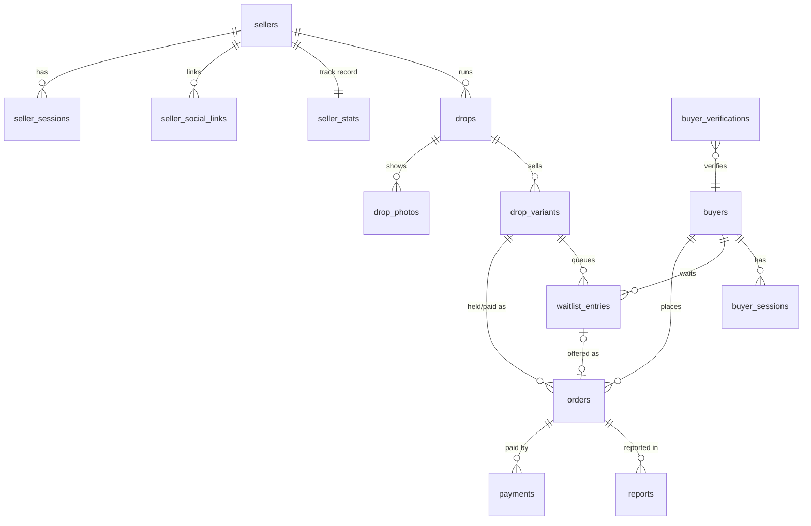

# Database schema — DropKilat

Source of truth: `migrations/`. This doc explains the why. PostgreSQL 17 in production; the initial migration was also verified on PostgreSQL 16 (up → down → up).

Conventions: `uuid` ids (UUIDv7 generated by the app), money in `BIGINT` rupiah, time in `timestamptz` UTC, enums as `text` + `CHECK`, PII encrypted by the app (`*_enc bytea`) with an HMAC lookup column (`*_hash bytea`).

## 1. Entity relationships



Standalone: `otp_challenges`, `webhook_events`, `outbox`, `audit_log`.

## 2. Tables

| Table | Purpose | Notes |
| --- | --- | --- |
| `sellers` | Shop account, verification timestamps, payment destination | `limited_until_trusted` drives new-seller limits |
| `seller_sessions` | Dashboard sessions | Token stored as SHA-256 hash |
| `otp_challenges` | OTP for seller login and buyer fallback | Max 5 attempts, code hashed |
| `seller_social_links` | IG/TikTok handle proof | `UNIQUE (platform, handle)` stops two shops claiming one handle |
| `seller_stats` | Track record shown to buyers | Updated by the app on order events |
| `drops` | One drop / PO | Status machine in `docs/app-flow.md` §2 |
| `drop_photos` | Photos | Files on the uploads volume |
| `drop_variants` | Variant with `stock_total` and `available` | **`CHECK (available >= 0 AND available <= stock_total)` is the last line against oversell** |
| `buyers` | Verified buyer phone | One row per phone across all shops |
| `buyer_sessions` | Buyer browser sessions (90 days) | |
| `buyer_verifications` | Pending buyer-initiated WA codes (`DK-XXXX`) | Page holds the nonce; WA webhook resolves the code |
| `orders` | Hold → paid → shipped → completed | Status machine in `docs/app-flow.md` §5 |
| `waitlist_entries` | FIFO queue per variant | One `waiting` row per buyer per variant (partial unique index) |
| `payments` | One row per payment attempt | `UNIQUE (provider, provider_ref)` |
| `webhook_events` | Raw inbound webhooks (Xendit, WhatsApp) | `UNIQUE (provider, event_id)` = idempotency |
| `outbox` | Side effects to deliver (WA messages) | `dedupe_key` stops duplicate sends |
| `reports` | Buyer reports | |
| `audit_log` | Append-only log of money and trust actions | App role has no UPDATE/DELETE |

## 3. Indexes that matter

| Index | Serves |
| --- | --- |
| `orders_hold_expiry_idx (hold_expires_at) WHERE status='held'` | Expiry worker scan |
| `orders_drop_buyer_active_idx (drop_id, buyer_id) WHERE active` | Max-per-buyer check |
| `waitlist_fifo_idx (variant_id, created_at, id) WHERE status='waiting'` | Promotion picks the oldest entry |
| `waitlist_one_waiting_per_buyer` (unique, partial) | No double queueing |
| `outbox_due_idx (send_after) WHERE pending` | Outbox worker |
| `drops_schedule_idx (status, opens_at)` | Scheduler opens/closes drops |

## 4. Row level security

Tenant tables (`drops`, `drop_photos`, `drop_variants`, `orders`, `waitlist_entries`, `payments`, `seller_social_links`, `reports`) have `FORCE ROW LEVEL SECURITY` with one policy:

```sql
USING (app_is_system() OR seller_id = app_seller_id())
```

The app connects as `dropkilat_app` (not the owner) and sets per transaction:

| Context | Setting |
| --- | --- |
| Seller dashboard request | `SET LOCAL app.seller_id = '<seller uuid>'` |
| Workers, webhook processing | `SET LOCAL app.role = 'system'` |
| Buyer-facing reads and claims | `SET LOCAL app.role = 'public'` |

With nothing set, tenant tables return zero rows. Verified: as seller B, `SELECT count(*) FROM orders` returns 0 while seller A has orders; `DELETE FROM audit_log` as the app role fails with permission denied.

RLS is the second line of defence. Every seller query still filters by `seller_id` explicitly, and buyer queries filter by `buyer_id` from the session.

## 5. Claim query (verified)

Run in one transaction. Verified with 40 concurrent buyers on 5 stock: exactly 5 `held` orders, `available = 0`.

```sql
BEGIN;
SET LOCAL app.role = 'public';
-- 1. serialize this buyer within this drop (max_per_buyer check without races)
SELECT pg_advisory_xact_lock(hashtextextended($1::text || $2::text, 0));   -- drop_id, buyer_id
-- 2. active orders of this buyer in this drop
SELECT coalesce(sum(qty), 0) FROM orders
 WHERE drop_id = $1 AND buyer_id = $2
   AND status IN ('held','proof_submitted','paid','shipped','completed','disputed');
--    if count + qty > drops.max_per_buyer → abort with "already_claimed"
-- 3. atomic decrement + hold
WITH dec AS (
  UPDATE drop_variants SET available = available - $3          -- qty
   WHERE id = $4 AND drop_id = $1 AND available >= $3           -- variant_id
  RETURNING id, price, seller_id, drop_id)
INSERT INTO orders (code, seller_id, drop_id, variant_id, buyer_id, qty, unit_price, amount,
                    payment_mode, status, hold_expires_at)
SELECT $5, seller_id, drop_id, id, $2, $3, price, price * $3, $6, 'held',
       now() + make_interval(mins => $7)
  FROM dec
RETURNING id;
--    0 rows → INSERT INTO waitlist_entries ... ON CONFLICT DO NOTHING; return position
-- 4. INSERT INTO outbox (kind 'wa.payment_link', dedupe_key 'order:<id>:payment_link')
COMMIT;
```

The drop must be `live` and `now()` between `opens_at` and `closes_at`; check it in the same transaction (`SELECT ... FROM drops WHERE id = $1 AND status = 'live' FOR SHARE`).

## 6. Expiry and promotion (verified)

One transaction per expired order; several workers can run in parallel thanks to `SKIP LOCKED`. Verified with 3 parallel workers: 2 expired holds → 2 waitlist buyers promoted, `available` back to 0, the third waiting buyer untouched.

```sql
BEGIN;
SET LOCAL app.role = 'system';
-- 1. expire one hold and return its stock
WITH exp AS (
  SELECT o.id FROM orders o JOIN drops d ON d.id = o.drop_id
   WHERE o.status = 'held'
     AND o.hold_expires_at + make_interval(secs => d.grace_seconds) < now()
   ORDER BY o.hold_expires_at
   FOR UPDATE OF o SKIP LOCKED LIMIT 1),
upd AS (
  UPDATE orders o SET status = 'expired', ended_at = now()
    FROM exp WHERE o.id = exp.id
  RETURNING o.variant_id, o.qty)
UPDATE drop_variants v SET available = available + upd.qty
  FROM upd WHERE v.id = upd.variant_id
RETURNING v.id;                                   -- variant to promote on
-- 2. promote the oldest waiting buyer on that variant (if the drop is still live)
WITH nxt AS (
  SELECT w.id, w.buyer_id, w.qty, w.variant_id FROM waitlist_entries w
   WHERE w.variant_id = $variant AND w.status = 'waiting'
   ORDER BY w.created_at, w.id
   FOR UPDATE SKIP LOCKED LIMIT 1),
dec AS (
  UPDATE drop_variants v SET available = available - nxt.qty
    FROM nxt WHERE v.id = nxt.variant_id AND v.available >= nxt.qty
  RETURNING v.id, v.price, v.seller_id, v.drop_id, nxt.buyer_id, nxt.qty, nxt.id AS entry_id),
ins AS (
  INSERT INTO orders (code, seller_id, drop_id, variant_id, buyer_id, qty, unit_price, amount,
                      payment_mode, source, status, hold_expires_at)
  SELECT $code, seller_id, drop_id, id, buyer_id, qty, price, price * qty,
         $mode, 'waitlist', 'held', now() + make_interval(mins => $hold)
    FROM dec
  RETURNING id)
UPDATE waitlist_entries w SET status = 'offered', offered_at = now(), order_id = ins.id
  FROM ins, dec WHERE w.id = dec.entry_id;
-- 3. outbox 'wa.waitlist_turn' for the promoted buyer
COMMIT;
```

Before promoting, skip entries whose buyer already has an active order in the drop (`status = 'skipped'`). The same promotion step runs when a hold is cancelled or a manual proof is rejected.

## 7. Webhook idempotency

```sql
INSERT INTO webhook_events (provider, event_id, event_type, payload)
VALUES ($1, $2, $3, $4)
ON CONFLICT (provider, event_id) DO NOTHING
RETURNING id;      -- no row → duplicate: answer 200, do nothing
```

Processing then locks the order (`SELECT ... FOR UPDATE`) and applies the transition only if the current status allows it. `processed_at` and `result` are set in the same transaction.

## 8. Retention and privacy

| Data | Kept for |
| --- | --- |
| Shipping address, recipient phone | Deleted 90 days after `completed` / `refunded` |
| Payment proofs | Deleted 90 days after order end |
| `webhook_events.payload` | 180 days |
| `audit_log` | 2 years |
| Expired `buyer_verifications`, consumed `otp_challenges` | 7 days |

A nightly job (`retention`) performs the deletes and writes one `audit_log` row per run.

## 9. Migration rules

1. Forward-only in production; every `up` has a `down` for local use.
2. Never edit a merged migration. Add a new one.
3. New tenant tables must include `seller_id` and the RLS policy in the same migration.
4. Run `make migrate-check` (up → down → up on a fresh DB) in CI.
