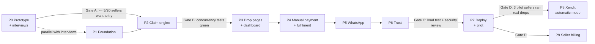

# Implementation plan — DropKilat MVP

Owners: **Claude** (tech lead, TL) · **Codex** (full-stack, FS) · **Gemini** (QA) · **Nur** (product owner, PO).
Every task follows `docs/agents/workflow.md`: TL writes the task card → FS implements → QA tests and reviews → TL reviews and merges → PO accepts at phase gates.

Estimates are working days for one agent session per day with human supervision. They are guesses; re-plan at each gate.

## Phase overview

Xendit (P8) is last on purpose: Manual mode lets pilots run without waiting for payment-gateway answers.

**Sequencing decision (PO, 2026-11-11):** P1 runs in parallel with the interviews. P2 and every later phase wait for Gate A.

**Design decisions on 2026-11-11** that every card below follows: ADR 0004 (RLS contexts), ADR 0005 (FIFO waitlist, stock accounting, `$now` in SQL), ADR 0006 (pricing and billing), ADR 0007 (in-process SSE), ADR 0003 amendment (phishing).

## P0 — Prototype for interviews (≈ 3 days)

| ID | Task | Owner | Acceptance criteria |
| --- | --- | --- | --- |
| T-001 ✅ done | Clickable prototype in `prototype/` (static HTML/CSS/JS, no backend): screens B1→B2→B3→B6, live-looking countdown and stock, button "Simulasikan pembeli pertama tidak bayar" that moves stock to waitlist #1 and shows a mock WA bubble | FS | Opens from a phone via a static host; works offline after load; no console errors; Bahasa Indonesia copy from `docs/design.md` |
| T-002 ✅ done | Prototype review: accessibility, copy, mobile viewport 360 px | QA | Report in `docs/tasks/T-001-qa.md` (combined with T-001); contrast ≥ 4.5:1; tap targets ≥ 44 px |
| T-003 | Interview kit: link prototype in the interview script, tally sheet | PO | 20 interviews logged |

**Gate A (PO):** ≥ 5 of 20 sellers agree to try it on a real drop. If not, stop and revisit the PRD. Status: open (interviews not started as of 2026-11-12).

## P1 — Foundation (≈ 4 days, may start before Gate A)

Cards: `docs/tasks/T-101.md` … `T-105.md`.

| ID | Task | Owner | Acceptance criteria |
| --- | --- | --- | --- |
| T-101 | Go module, `cmd/dropkilat` main with graceful shutdown, `platform/config` (fail-fast env parsing), `platform/clock` | FS | `make run` serves `/healthz`; missing env var → exit 1 with clear message |
| T-102 | `platform/db`: pgx pool, `WithSellerTx` / `WithSystemTx` / `WithBuyerTx` / `WithPublicTx`; migration `000002_rls_contexts` (ADR 0004); migrate command | FS | Integration tests reproduce the ADR 0004 result table through the helpers |
| T-103 | `platform/httpx`: router, request id, slog, recover, security headers, problem+json, rate limiter (token bucket, in-memory) | FS | Unit tests for problem mapping and rate limiter |
| T-104 | CI: create `dropkilat_app` role, golangci-lint, `go test`, testcontainers, `govulncheck`, `make migrate-check`, prototype tests, pinned tool versions, build distroless image | FS | Green pipeline on an empty feature; image < 40 MB |
| T-105 | Test strategy doc `docs/test-plan.md` and test helpers (`testdb` fixture, factories, fake clock) | QA | Plan covers every NFR in TRD §3 with a named test |

## P2 — Claim engine (≈ 5 days)

| ID | Task | Owner | Acceptance criteria |
| --- | --- | --- | --- |
| T-201 | `drop` service: create/update/publish/close/add stock with validation and lifecycle rules | FS | Unit tests for every transition in app-flow §2; live drop rejects price change; Otomatis drop rejects variant price < Rp20.000 |
| T-202 | `buyer` minimal: create buyer + session from a verified phone (verification itself in P5; dev endpoint behind `DK_ENV=dev`) | FS | Dev endpoint absent in prod build tag |
| T-203 | `order.Claim` + `waitlist.Enqueue` + `waitlist.PromoteFit` exactly as `docs/database-schema.md` §5–6; migration `000003_orders_holds_stock` | FS | Returns held or waitlisted, never both; max_per_buyer enforced; no claim takes stock while someone waits; `$now` from clock |
| T-204 | `expirer` worker, buyer cancel, stock increase on live drop, each followed by `PromoteFit` (§6, §6a paths 3, 4, 9) | FS | Fake-clock test: release ≤ 5 s after `expires_at + grace`; promoted buyer gets fresh hold; first-fit and skip cases covered |
| T-205 | Concurrency suite: 500 goroutines claim 50 stock; 3 expirer goroutines; random cancels; stock increases | QA | Over 50 runs: `available + Σ qty(holds_stock) = stock_total`; no buyer twice in `waiting`; promotions in FIFO order (first fit); no newcomer served while an entry that fits waits |
| T-206 | Property test for order state machine (random valid/invalid transitions) | QA | Invalid transitions always `invalid-transition`; stock invariant holds |

**Gate B (TL):** T-205 and T-206 green in CI for 3 consecutive runs.

## P3 — Drop pages and seller dashboard (≈ 6 days)

| ID | Task | Owner | Acceptance criteria |
| --- | --- | --- | --- |
| T-301 | templ base layout, Tailwind build, design tokens from `docs/design.md` | FS | Buyer page < 150 KB excluding photos |
| T-302 | Buyer drop page B1/B2/B3/B6/B7 with SSE stock updates (in-process hub, ADR 0007) and claim | FS | Playwright: claim → hold timer visible; sold out → waitlist position |
| T-303 | Seller login (OTP via fake sender in dev), session, CSRF | FS | Session token hashed in DB; CSRF missing → 403 |
| T-304 | Drop editor S4 with photo upload (re-encode, size limit) | FS | Upload rejects non-images and > 5 MB |
| T-305 | Live monitor S5 with SSE counters and emergency close | FS | Counters update within 2 s of a claim |
| T-306 | E2E suite for P3 flows; IDOR checks (buyer A opening buyer B's order, seller A opening seller B's drop), also with RLS alone (no `WHERE`) | QA | All IDOR attempts return 404 |

## P4 — Manual payment and fulfilment (≈ 5 days)

| ID | Task | Owner | Acceptance criteria |
| --- | --- | --- | --- |
| T-401 | Seller payment destination (QRIS image, bank account encrypted) | FS | Account number never logged or shown unmasked except to the buyer during an active hold |
| T-402 | Proof upload, `proof_submitted`, seller confirm/reject queue (S6) with promotion on reject | FS | Reject releases stock and promotes waitlist in one transaction |
| T-403 | Address form, ship (single + CSV bulk), received, auto-complete, report | FS | All transitions per app-flow §5 |
| T-404 | CSV export and label print view | FS | CSV opens correctly in Excel and Google Sheets (UTF-8 BOM, `;` option) |
| T-406 | Proof review deadline (60 min live / 6 h otherwise), `reviewer` worker, late flag + seller warning, buyer cancel after 6 h, "Tolak dan blokir pembeli di toko ini" (`docs/tasks/T-406.md`) | FS | Fake-clock tests on both deadlines; reject+block in one transaction; blocked buyer gets `buyer-blocked` on claim and is skipped in promotion |
| T-407 | Usage meter: confirmed Manual orders per seller per month, dashboard meter, pilot exemption (`docs/tasks/T-407.md`) | FS | Counter equals a SQL recount; nothing is blocked above 50 |
| T-405 | Test pass on P4 (incl. T-406, T-407) + upload security tests (polyglot files, huge images, path tricks) | QA | Report with zero open high-severity issues |

## P5 — WhatsApp (≈ 4 days)

| ID | Task | Owner | Acceptance criteria |
| --- | --- | --- | --- |
| T-501 | `notify` outbox worker with retries, dedupe, dead letters; fake sender | FS | Message sent at most once per `dedupe_key` |
| T-502 | WhatsApp Cloud API sender + webhook (signature check) | FS | Signature mismatch → 401, event not stored |
| T-503 | Buyer-initiated verification flow (app-flow §3) + OTP fallback + phishing mitigations (ADR 0003 amendment: 5-min single-use code, explaining reply, masked data with step-up, purpose in prefill) | FS | Code expires in 5 min; one code binds one phone; earlier addresses masked without step-up |
| T-504 | Template vs free-form decision using last inbound time | FS | Unit tests around the 24 h boundary |
| T-505 | Tests: webhook replay, forged signature, code brute force (rate limits), forwarded-code phishing scenario | QA | All blocked; metrics show attempts; phished session cannot see unmasked PII |

## P6 — Trust (≈ 4 days)

| ID | Task | Owner | Acceptance criteria |
| --- | --- | --- | --- |
| T-601 | Verification levels and badges; owner review screen for manual identity check | FS | Unverified seller cannot publish (`seller-not-verified`) |
| T-602 | Social link with bio code (owner confirms manually in MVP) | FS | One handle cannot be linked by two shops |
| T-603 | `seller_stats` updates and TrustHeader on the drop page | FS | Numbers match a SQL recount in tests |
| T-604 | New-seller limits | FS | 31st stock unit or value > Rp5.000.000 → `new-seller-limit` while limited |
| T-605 | Abuse tests: fake seller flows, report spam, impersonation via slug | QA | Report with mitigations verified |

## P7 — Hardening, deploy, pilot (≈ 5 days)

| ID | Task | Owner | Acceptance criteria |
| --- | --- | --- | --- |
| T-701 | k6 scenario: 500 claims in 10 s on 50 stock + 200 SSE clients, on the target VM | QA | NFR-2, NFR-3 met; report with graphs |
| T-702 | Security review against TRD §7 (OWASP ASVS L1 subset) | QA | No open high/critical findings |
| T-703 | Deploy: Docker Compose + Caddy, backups (`pg_dump` nightly, encrypted, off-VM), restore drill, deploy guard during live drops | FS | Restore drill documented in `deploy/RUNBOOK.md` |
| T-704 | Privacy: retention job, data export/delete for a buyer | FS | Job tested with fake clock |
| T-705 | Pilot with 3 sellers, PO on call during drops | PO | Metrics captured per PRD §3 |

**Gate C (TL + QA):** T-701 and T-702 pass before any real seller uses it.
**Gate D (PO):** 3 pilot sellers ran real drops and at least 2 want to continue.

## P8 — Xendit automatic mode (after confirmation from Xendit)

| ID | Task | Owner | Acceptance criteria |
| --- | --- | --- | --- |
| T-801 | Confirm with Xendit: QRIS + split on sub-accounts, entity requirement, settlement time (PO) | PO | Written answers stored in `docs/adr/` |
| T-802 | `payment/xendit`: sub-account creation, KYC status webhook | FS | Works against Xendit test mode |
| T-803 | Dynamic QRIS with `for-user-id` + `with-split-rule`, expiry = hold end | FS | Paid webhook → order `paid` ≤ 10 s |
| T-804 | Late payment handling and refunds | FS | Expired + paid → re-reserve or `refund_pending` |
| T-805 | Payment test suite: duplicate webhooks, out-of-order events, amount mismatch, forged token | QA | One state change per payment in every case |
| T-806 | Otomatis eligibility (≥ 15 orders/month) and fee min Rp1.000 / max Rp7.500 (ADR 0006) | FS | Below threshold → `otomatis-not-eligible`; fee table tests at the min/max boundaries |

## P9 — Seller billing (after Gate D)

| ID | Task | Owner | Acceptance criteria |
| --- | --- | --- | --- |
| T-901 | Monthly invoice for Manual orders above 50/month at Rp1.000 each (`docs/tasks/T-901.md`, ADR 0006) | FS | Invoice lines equal a SQL recount; no buyer money involved; PO tax/legal check done before the first real invoice |

## Definition of done (every task)

1. Code + tests merged on `main` through a reviewed PR.
2. QA report attached for tasks owned by FS (or explicit "no QA needed" from TL for chores).
3. Docs updated when behaviour, API, schema or config changed.
4. No new lint or `govulncheck` findings.
