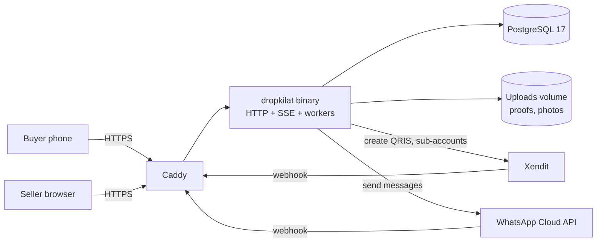

# TRD — DropKilat MVP

Tech lead: Claude · Status: draft v1.1 · Updated: 2026-11-11

## 1. Architecture

One Go binary (modular monolith) running the HTTP server and background workers, one PostgreSQL database. No Redis or message broker in the MVP: PostgreSQL is the single source of truth for stock.

Workers inside the same binary:
- `expirer` — releases expired holds and promotes the waitlist (every 2 s).
- `outbox` — delivers WhatsApp messages and other side effects with retries.
- `scheduler` — opens and closes drops on time; auto-completes shipped orders.
- `reviewer` — flags manual proofs past their review deadline and warns the seller.
- `invoicer` — monthly seller invoices (after Gate D, ADR 0006).

## 2. Stack

| Concern | Choice | Notes |
| --- | --- | --- |
| Language | Go 1.27 | Standard library first |
| HTTP | `net/http` (Go 1.22+ routing patterns) | No framework |
| HTML | `templ` + htmx + small vanilla JS | Server-rendered; JS only for timer, SSE, upload |
| CSS | Tailwind CSS standalone CLI | No Node at runtime |
| Real time | Server-Sent Events | One-way stock and status updates; in-process hub (ADR 0007) |
| DB | PostgreSQL 17 | `pgx/v5`, `sqlc` for typed queries |
| Migrations | `golang-migrate` | Files in `migrations/` |
| Payments | `payment.Provider` interface: `manual`, `xendit`, `fake` | Xendit behind feature flag |
| WhatsApp | Meta WhatsApp Cloud API via `notify.Sender` interface; `fake` sender in dev/test | |
| Files | Local volume in MVP behind `storage.Store` interface | Swap to S3/R2 later |
| Tests | `go test`, testcontainers-go (PostgreSQL), k6, Playwright | |
| CI | GitHub Actions: lint, test, govulncheck, build image | |
| Deploy | Docker Compose + Caddy on the 2 vCPU / 4 GB VM | Distroless image |

Decisions are recorded in `docs/adr/`.

## 3. Non-functional requirements

| ID | Requirement | Target | Verified by |
| --- | --- | --- | --- |
| NFR-1 | No oversell | 0 orders beyond stock under any concurrency | Concurrency test + DB constraint |
| NFR-2 | Claim latency | p95 < 300 ms, p99 < 800 ms at 50 claims/s | k6 |
| NFR-3 | Burst | 500 claims in 10 s on 50 stock → exactly 50 holds | k6 + DB check |
| NFR-4 | Stock freshness | Buyer sees stock change within 2 s | SSE test |
| NFR-5 | Expiry precision | Hold released ≤ 5 s after `expires_at + grace` | Integration test with fake clock |
| NFR-6 | Payment idempotency | Same webhook delivered N times → one state change | Integration test |
| NFR-7 | Buyer page weight | < 150 KB excl. photos; first render < 1.5 s on Fast 3G | Lighthouse |
| NFR-8 | Availability | No planned downtime while any drop is live | Deploy check refuses during live drops |
| NFR-9 | Recovery | Daily DB backup, restore tested monthly; RPO 24 h, RTO 4 h | Runbook |
| NFR-10 | Resource budget | App ≤ 512 MB RAM, DB ≤ 1.5 GB on the VM | Monitoring |

## 4. Concurrency design (the core)

Claim is one transaction under the `system` RLS context (ADR 0004). Exact SQL: `docs/database-schema.md` §5. The order of steps is:

1. Check the drop is live (plain read, using `$now` from `clock.Clock`).
2. Take `pg_advisory_xact_lock(drop, buyer)` and check `max_per_buyer`.
3. Lock the variant row (`FOR UPDATE`).
4. **Queue first.** If nobody is waiting and `available >= qty`, decrement and insert a `held` order. Otherwise enqueue the buyer and run `PromoteFit`.
5. Write the outbox message and commit.

Safety nets in the database:
- `CHECK (available >= 0)` and `CHECK (available <= stock_total)`;
- a partial unique index preventing two active waitlist entries for the same buyer and variant;
- `orders.holds_stock` with a CHECK that released statuses hold no stock.

The invariant `available + Σ qty(holds_stock) = stock_total` is tested (ADR 0005).

Expiry and promotion run in one transaction per order using `FOR UPDATE SKIP LOCKED`, so several worker loops never process the same row. Promotion is first fit in FIFO order and loops until stock or the queue runs out. See `docs/database-schema.md` §6–6a.

Hot-row note: one variant row receives all decrements. At MVP scale (≤ 100 claims/s) PostgreSQL row locking is enough. If NFR-2 fails under load, the fallback is splitting stock into N shard rows per variant (ADR to be written then), not Redis.

## 5. Payments

Two modes per drop (`payment_mode`):

- **manual** — the page shows the seller's own payment destination. Buyer uploads proof; seller confirms. DropKilat never touches money.
- **xendit** — dynamic QRIS created for the seller's xenPlatform sub-account (`for-user-id` header) with the platform split rule (`with-split-rule`). QRIS expiry = hold end. Webhook marks the order paid.

Rules:
1. Every webhook is stored in `webhook_events` first with a unique `(provider, event_id)`; processing is idempotent.
2. Verify webhook authenticity (Xendit callback token, constant-time compare).
3. Late payment after expiry: try to re-reserve the same variant; if no stock, refund automatically and notify.
4. Amounts are `BIGINT` rupiah. No floats anywhere in money code.

## 6. Identity and authentication

- **Seller**: WhatsApp OTP login (6 digits, 5 min, max 5 attempts, rate-limited). Session: random 256-bit token in an `HttpOnly; Secure; SameSite=Lax` cookie, stored hashed (SHA-256) in `seller_sessions`. CSRF token on all state-changing dashboard requests.
- **Buyer**: buyer-initiated WhatsApp verification. Page shows a code (valid 5 minutes, single use); the buyer sends it to our number via a `wa.me` link; the inbound webhook binds the phone to the browser's pending verification and replies with what the code was for. Fallback: OTP template. Buyer session cookie lasts 90 days; showing saved personal data needs a step-up verification within 10 minutes (ADR 0003 amendment).
- Phone numbers stored normalized E.164, encrypted (AES-256-GCM, key from env) plus a keyed hash (HMAC-SHA256) for lookup.

## 7. Security requirements

| Area | Requirement |
| --- | --- |
| Authorization | Every seller query is scoped by `seller_id`; PostgreSQL RLS as a second line with four contexts: `system`, seller, `buyer`, `public` (ADR 0004). Buyers can only read their own orders (order id + buyer session), enforced by RLS too. |
| IDs | Public IDs are random (UUIDv7 internally, short random codes for order codes); never sequential in URLs. |
| Rate limits | Claim: 5/min per buyer, 60/min per IP. OTP: 3 per 15 min per number. Proof upload: 5 per order. |
| Uploads | ≤ 5 MB; sniff content type (JPEG, PNG, WebP, PDF only); re-encode images; random file names; served with `Content-Disposition` and `X-Content-Type-Options: nosniff`. |
| Webhooks | Signature/token check, replay protection via event id, body size limit 1 MB. |
| Secrets | Env vars only; never logged. `.env` is git-ignored. |
| Headers | CSP (self + fonts), HSTS, frame-ancestors none, Referrer-Policy strict-origin-when-cross-origin. |
| Audit | Append-only `audit_log` for money and trust events (confirm, reject, refund, verification changes, drop close). |
| Privacy | UU PDP: purpose limitation, addresses deleted 90 days after completion, export/delete on request. |

## 8. Observability

- Structured JSON logs (`log/slog`) with request id; no PII in logs (phones masked).
- Prometheus metrics at `/metrics` (internal only): `dropkilat_claims_total{result}`, `dropkilat_holds_active`, `dropkilat_expiry_lag_seconds`, `dropkilat_outbox_pending`, `dropkilat_webhook_events_total{provider,result}`, HTTP latency histograms.
- Health: `/healthz` (process), `/readyz` (DB reachable, migrations current).

## 9. Configuration

All via env, prefix `DK_`. See `.env.example`. Feature flags: `DK_FEATURE_XENDIT`, `DK_FEATURE_WA_SEND` (false = fake sender logs messages).

## 10. Constraints and assumptions

- Single VM (2 vCPU, 4 GB, 30 GB disk) until > 30 active sellers.
- Time zone stored as UTC; displayed in the seller's zone.
- Xendit capabilities in §5 are **unconfirmed** (see PRD open questions). Manual mode must ship without them.
